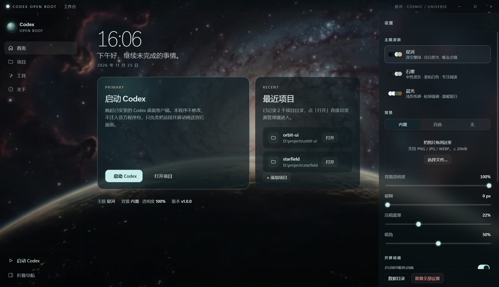

<div align="center">



# Codex Open Boot

**A 10-second splash animation that lands in a themeable workbench, then hands you back to Codex.**

[](https://github.com/cl1973-hello/codex-open-boot/releases)
[](LICENSE)
[](#requirements)

[中文](README.md) · [Download](https://github.com/cl1973-hello/codex-open-boot/releases/latest) · [FAQ](#faq)

</div>


---

## Quick start (3 steps)

1. Open the [latest release](https://github.com/cl1973-hello/codex-open-boot/releases/latest).
2. Download **`CodexOpenBoot-x.y.z-win-x64-portable.exe`** (single file, no installer).
3. Double-click it. Ten seconds later you are in the workbench.

> **No Node.js, no terminal, no administrator rights.**
> Windows SmartScreen may warn about an unknown publisher — that is normal for unsigned
> binaries. Click **More info → Run anyway**. Prefer a start-menu entry? Grab the
> `...-setup.exe` instead.

---

## What it does

The splash video, the transition and the workbench all live in **one window, one document**.
Inside the footage there is a rectangular screen; the workbench is mounted at its final size,
uniformly scaled into that rectangle, and scaled back up as the rectangle grows. The last
620 ms close the remaining gap to the full window — no page navigation, no second window,
therefore no black or white flash.

It is **not** a Codex replacement. It never patches, injects into or repackages the official
client. "Launch Codex" simply asks Windows to activate the installed app identity.

---

## Features

- Splash video with `Esc` / skip, and a keyframe-driven transition into the workbench.
- Three skins (Cosmic / Graphite / Daylight) with a 220 ms colour transition.
- Background: built-in still, your own image, or none — with **opacity 0–100 %**, blur,
  scrim and vignette.
- Readability guard: if the picture makes text unreadable, the scrim deepens automatically
  and tells you why (WCAG AA 4.5:1).
- Calibration panel (`Ctrl+Shift+C`) to re-align the keyframes for **your own** video.
- Launch the real Codex client with a configurable AppID, with a human-readable error path.
- Everything persists in `%APPDATA%\CodexOpenBoot`: skin, background, opacity, volume,
  window bounds.

## Theming and backgrounds

Right-hand panel → **Background**: drag an image onto the dashed area (PNG/JPG/WEBP/BMP,
≤ 20 MB) or pick a file; then drag **opacity** to taste. The image is copied into your user
data folder, so moving or deleting the original does not break it.

Right-hand panel → **Theme**: pick a skin. Reset everything with **Reset all settings** at
the bottom of the panel.

## Use your own splash video

1. Provide an **MP4 with H.264 + AAC** (16:9, 8–15 s recommended).
2. Replace `assets/media/video.mp4` with it.
3. Open the workbench → **Tools → Calibrate animation** (`Ctrl+Shift+C`), drag the rectangle
   onto the screen in your footage, drag the `start` / `end` markers on the timeline, press
   **Preview tail**, then **Save**.

Calibration is written to `%APPDATA%\CodexOpenBoot\theme.json`, never to the repository.

---

## FAQ

**SmartScreen / antivirus warning?** Expected for unsigned software. The whole source is
here and every installer is built by GitHub Actions (`release.yml`); each release ships
`SHA256SUMS.txt`. You can always build it yourself.

**Black splash or no audio?** Unsupported codec (use H.264 + AAC), or a Windows "N" edition
missing media features. You can also just disable the animation in settings.

**"Launch Codex" does nothing?** Install the Codex desktop client first. If it is installed,
the AppID probably changed — run `Get-StartApps | findstr /i codex` in PowerShell and paste
the whole `AppID` value into Settings → Client → Codex AppID.

**How do I uninstall?** Uninstall from Windows Settings (installer) or delete the exe
(portable). Settings and backgrounds live in `%APPDATA%\CodexOpenBoot`.

**Does it auto-start or upload anything?** No. No autostart entry, no background service, no
network access unless you click a link.

---

## Something else broken?

Open an [issue](https://github.com/cl1973-hello/codex-open-boot/issues/new?template=bug_report.md)
and attach the log file the template asks for:

```
%APPDATA%\CodexOpenBoot\launcher.log
```

Tools → Open log inside the workbench jumps straight there.

---

## Requirements

Windows 10 1809+ / Windows 11, x64. ~250 MB of disk. No dedicated GPU needed.

## Notes

- Personal project, **not affiliated with OpenAI**. No official Codex assets are bundled.
- The video and stills in `assets/media/` are **not** MIT licensed — see
  [MEDIA_NOTICE.md](MEDIA_NOTICE.md) before redistributing.
- Windows x64 only. Other platforms are untested.

## Project structure

```
src/main/       Electron main: window, settings, theme loading, IPC, launching Codex
src/preload/    The only bridge, exposes named methods
src/shared/     Pure functions: keyframe geometry, validation, WCAG contrast (unit tested)
src/renderer/   UI without a framework: splash/, workbench/, calibration/, styles/
assets/media/   Splash video, stills, theme.json, skins.json
test/           20 unit tests (node --test)
scripts/        Bundling, dev loop, icon and demo-gif generation
.github/        CI + tag-driven release workflow
```

## Development

```bash
npm install
npm run dev      # rebuild + restart on change
npm test
npm run dist     # portable + installer into release/
```

Geometry in one line: `screenFrames` are normalised rectangles over the video frame; the
renderer computes the `object-fit` display rect, interpolates the keyframes, converts to
pixels and derives an integer portal rect plus a uniform scale factor. The workbench is laid
out at final size and scaled, so text never reflows.

See [CONTRIBUTING.md](CONTRIBUTING.md).

## Credits & license

- Code: [MIT](LICENSE) © 2026 cl1973-hello
- Design inspiration (no code copied): [dragon-codex-boot](https://github.com/yushua0808-cpu/dragon-codex-boot),
  [dragon-codex-boot-enhanced](https://github.com/knight458687810-code/dragon-codex-boot-enhanced) — both MIT.
  See [THIRD_PARTY_NOTICES.md](THIRD_PARTY_NOTICES.md).
