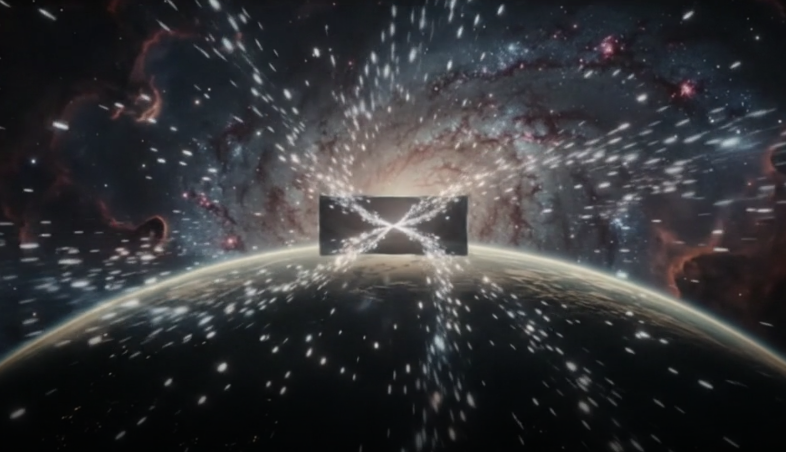
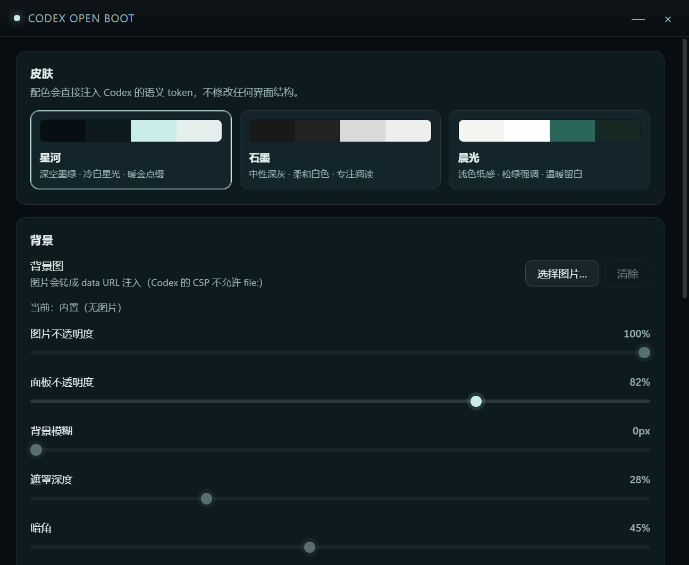

<div align="center">



# Codex Open Boot

**给真正的 Codex 客户端加一段开屏动画，并把它的界面换成你的配色。**

[](https://github.com/cl1973-hello/codex-open-boot/releases)
[](LICENSE)
[](#系统要求)
[](https://www.electronjs.org/)

[English](README.en.md) · [下载](https://github.com/cl1973-hello/codex-open-boot/releases/latest) · [硬限制](#五条硬限制) · [排查](#出问题了)

</div>

---

## 这不是一个启动器

| 你看到的 | 实际的实现 |
| --- | --- |
| 点开始菜单里的 **Codex**（官方那个） | 托盘里常驻的进程轮询发现 `ChatGPT.exe` 新起来，立刻抢屏 |
| 10 秒星空开屏 | 一个铺满屏幕的无边框窗口在放 `video.mp4` |
| 视频里那块屏幕「长大」 | 每一帧都按视频里那块矩形 `SetWindowPos` 真实的 Codex 窗口 |
| 开屏淡出，界面就在了 | 开屏窗 `setOpacity` 降到 0 后销毁，Codex 已经在下面铺好 |
| 界面变成墨绿配色 | 通过 CDP 注入 31 个 Codex 语义 token 的 CSS 变量 |

Codex 窗口在入场时刻就已经在渲染了 —— 它在开屏窗**下面**同步长大，所以交接的瞬间没有黑闪、没有白闪、也没有重新加载。

---

## 五条硬限制

这些不是「暂未实现」，是当前实现方式决定的上限。写在最前面，省得你踩坑。

**1. 只支持 Windows + 微软商店版 Codex。**
靠 `Get-AppxPackage OpenAI.Codex` 找安装路径、靠执行别名启动。绿色版 / 其他平台的 Codex 用不了。

**2. 接管时要重启一次 Codex。**
注入主题需要在启动时加 `--remote-debugging-port`，而 Codex 有单实例锁 —— 第二个实例的参数会被丢掉。所以你点开官方图标后，本工具会先结束那个刚起来的实例，再带参数重新启动。
已经由本工具启动过的 Codex（带调试端口）会直接接管，不会重启。Codex 本来就在跑的时候点图标，只会聚焦窗口，不重播开屏。

**3. 需要本程序常驻托盘。**
侦测靠托盘里那个 400ms 的轮询。从托盘「退出」之后，点官方图标得到的就是原生 Codex —— 没有开屏也没有主题。这是唯一必须记住的一条。

**4. 入场不能早于视频第 ~9.2 秒。**
Codex 窗口有 `WM_GETMINMAXINFO` 定下的 793×991 **物理像素**最小尺寸，改不掉。视频里那块矩形必须长到足够大才放得下窗口，165% 缩放下这个时刻是 9.22s。程序每次启动都会重算（`findEntryTime`），不和分辨率绑死；但视频总长度不能短于这个数字。

**5. 只换皮，不改布局。**
注入的是配色、背景图、透明度 —— 不移动按钮、不改字号、不重排面板。想改布局请去改 Codex 自己。

---

## 30 秒上手

1. 打开 [Releases](https://github.com/cl1973-hello/codex-open-boot/releases/latest)，下载名字以 `-portable.exe` 结尾的那个。
2. 运行它。第一次会先播一遍开屏，然后程序缩进托盘 —— **别退出托盘**，它要留着盯官方入口。
3. 之后就像平常一样点开始菜单 / 搜索里的 **Codex**，开屏会自动抢过来。

> 程序没有代码签名，Windows 会提示「已保护你的电脑」，点 **更多信息 → 仍要运行**。
> 它不需要管理员权限，也不会写入 Codex 的安装目录。



托盘的「设置」打开上面这个面板：三套皮肤、背景图（不透明度 / 模糊 / 遮罩 / 暗角）、开屏音量、入场后慢放速度、结束时窗口大小。改动即时推给已经打开的 Codex，不需要重启。

---

## 它怎么做到的

```
点开始菜单里的 Codex（官方磁贴）
   │
   ├─ 托盘里 400ms 一轮的进程枚举发现 ChatGPT.exe 从「没有」变成「有」（实测 3ms 内响应）
   │
   ├─ 全屏开屏窗口立刻显示（静帧垫底，视频接上不闪）
   │
   ├─ 后台：结束这个刚起来的实例 → 带 5 个调试参数重新启动 → 等 DevToolsActivePort
   │    （刚起来的那个没有调试端口，注入不了主题，所以必须换）
   │
   ├─ CDP 连上 app://-/index.html，注入 <style id="cob-theme">
   │    · 31 个 --app-color-* / --codex-theme-* 语义 token
   │    · 强制 <html data-theme> 到皮肤对应的一侧（否则侧栏还是浅色）
   │    · 页面刷新 / 重导航后靠事件 + 重试重新注入
   │
   ├─ 视频放到第 9.2 秒，真实窗口按帧缩放，跟着那块「屏幕」一起长大
   │    视频时间来自 requestVideoFrameCallback，不是墙上时钟
   │
   ├─ 尾段 400–1100ms 补间铺满工作区，HWND_NOTOPMOST
   │
   └─ 开屏窗 240ms 淡出 → 销毁 → 焦点交给 Codex → 驻留托盘
```

> 为什么不能直接改快捷方式：官方 Codex 是 MSIX **执行别名**
> （`%LOCALAPPDATA%\Microsoft\WindowsApps\chatgpt-desktop.exe`），没有 `.lnk` 可改，
> 也不能给它附加启动参数。所以只能「看见它起来 → 抢屏 → 换自己的参数重拉」。
> 判据只看「从零到有」：Codex 运行中自己派生新进程不算点击，否则会把用户正在用的窗口杀掉重开。

几个 M0 阶段踩出来的事实（完整记录见 [`.m0/M0-REPORT.md`](.m0/M0-REPORT.md)）：

- `Page.addScriptToEvaluateOnNewDocument` 在 `app://` 页面上**刷新后不执行**，只能用 `frameNavigated` / `loadEventFired` + 重试。
- Codex 会重置 `<html>` 上的 `data-*`，所以标记放在 `<style id="cob-theme">` 和 `window` 属性上，并挂一个 `MutationObserver`。
- Codex 的 CSP 里 `img-src` **没有 `file:`**，背景图必须转成 data URL。
- 页面外框画的是一层写死的 `linear-gradient(#181818 50%)`，不是语义 token，得单独接管。
- Electron 按 DIP 建窗口、Chromium 按取整后的 `devicePixelRatio` 绘制，两者差约 1%，所以窗口定位用的是「渲染层认为的物理视口」。

---

## 系统要求

| | |
| --- | --- |
| 系统 | Windows 10 1809+ / Windows 11 |
| Codex | 微软商店版（MSIX，包名 `OpenAI.Codex`） |
| 权限 | 普通用户即可 |
| 依赖 | 无。不需要 Node、不需要装驱动 |
| 显示 | 已在 2560×1440 @165% 单显示器验证；多显示器 / 混合 DPI 未测试 |

---

## 换成自己的开屏视频

`assets/media/theme.json` 描述视频和「屏幕轨迹」：

```json
{
  "duration": 10.027,
  "video": "video.mp4",
  "poster": "poster.png",
  "transitionStart": 6.8,
  "transitionEnd": 9.9,
  "fit": "cover",
  "zoom": 1.33,
  "screenFrames": [
    { "time": 6.8, "x": 0.3141, "y": 0.3486, "width": 0.3711, "height": 0.3028 }
  ]
}
```

- `screenFrames` 是**归一化**矩形（0..1，相对视频画面），每 100ms 一帧，用线性插值。
- `zoom` 用来裁掉视频自带的黑边（>1 放大，边缘被裁）。
- 把 `theme.json` 和视频放进 `%APPDATA%\CodexOpenBoot\` 可以覆盖内置素材，不用重新打包。

---

## 出问题了

日志在 `%APPDATA%\CodexOpenBoot\launcher.log`（托盘 → 打开日志）。

| 现象 | 原因 / 处理 |
| --- | --- |
| 点 Codex 没有开屏 | 托盘里程序没在跑（从托盘退出了）。重新运行一次本程序，它会缩回托盘 |
| 点 Codex 之后闪了一下才出开屏 | 正常：接管要结束刚起来的官方实例再重拉，约 1.5 秒，开屏一般已经盖在上面 |
| 用着用着 Codex 自己重启了 | 不该发生。把日志发出来 —— 侦测只认「从零到有」，运行中长出子进程不会接管 |
| 界面还是浅色 | Codex 不是本工具启动的。托盘 → 重新播放开屏 |
| 侧栏 / 输入框颜色没变 | Codex 更新改了 token。跑 `npm run probe` 看注入结果，见下 |
| 开屏放完窗口很小 | 上一次动画中途被强杀。下次启动会自动还原，或托盘 → 恢复窗口尺寸 |
| 提示被安全软件拦截 | 加白名单，或改用 `--setup.exe` 安装版 |

**`npm run probe`** 会完整跑一次开屏并输出一份可核对的结果：入场时间、入场矩形、尾段时长、主题注入页面数、以及「视频矩形」在渲染层和主进程两侧算出来的偏差（验收要求 ≤2px，实测 0.0px）。结果写到 `.probe/report.json`。

排查渲染层：`COB_DEBUG_PORT=9333 npm start`，然后用 Chrome 打开 `http://127.0.0.1:9333` 就能看到开屏页的控制台和元素。

---

## 开发者

```bash
npm install
npm start            # 构建渲染层 + 启动（会重启一次 Codex）
npm run dev          # 改渲染层自动重编译、改主进程自动重启
npm test             # 纯函数单测：几何映射、矩形、token 生成、设置钳制
npm run probe        # 端到端测量
npm run check:entry  # 在临时目录里真建一遍 Codex.lnk，不动你的桌面
npm run pack         # 免安装目录
npm run dist         # portable + nsis 安装包
```

目录：

```
src/main/         主进程
  boot.js         开屏主流程（状态机：idle → running → done/failed）
  animate.js      按视频时间逐帧摆真实窗口
  win32.js        koffi 绑定 user32/dwmapi（只读窗口信息 + SetWindowPos）
  cdp.js          CDP 客户端 + 主题注入器
  launch.js       启动 Codex、找调试端口、退出旧实例
  theme.js        设置 + 皮肤 + 背景图 → 注入用的 CSS
  watcher.js      官方入口侦测（400ms 轮询，只认「从零到有」）
  processes.js    koffi 枚举进程（整轮约 3.6ms）
  entry.js        旧版 .lnk 的识别与清理（2.1 起不再创建）
  tray.js         托盘
src/shared/       纯函数（有单测，渲染层与主进程共用）
  portal.js       归一化矩形 → 像素矩形、入场时间
  theme-css.js    生成注入 Codex 的样式表
  geometry.js     几何基元
src/renderer/     开屏页 + 设置面板
test/             node:test
.m0/              M0 阶段的实测脚本与结论
```

### 它不做什么

- 不修改、不重打包、不替换 Codex 自己的文件（`app.asar` 一个字节都不动）。
- 不修改任何哈希类名 —— 只覆盖 CSS 变量，所以 Codex 更新后最多是「颜色没生效」，不会白屏。
- 不联网。除了 CDP 的 `127.0.0.1`，没有任何出站请求。
- 不上传遥测。

---

## 许可

代码 [MIT](LICENSE)。开屏视频、静帧、皮肤配色为示例素材，来源与授权状态见 [MEDIA_NOTICE.md](MEDIA_NOTICE.md) —— **发布前请替换成你有权使用的素材**。

Codex 是 OpenAI 的产品，本项目与 OpenAI 无关。
