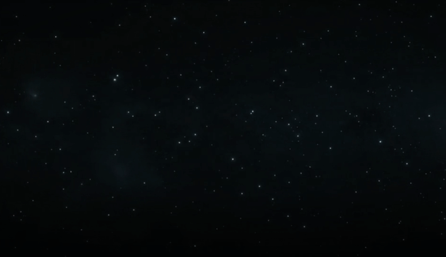
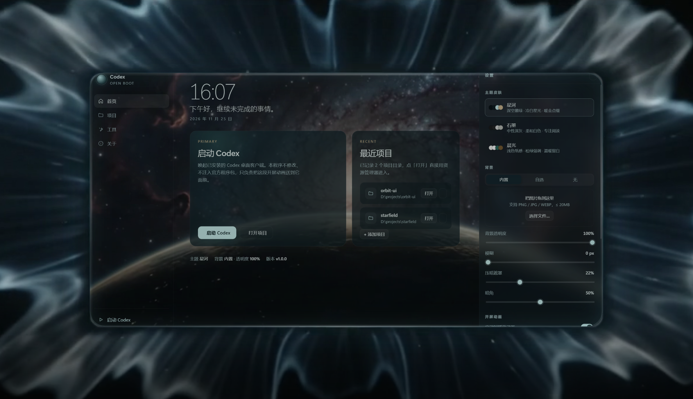

<div align="center">


# Codex Open Boot

**给 Codex 加一段 10 秒的开屏动画，落进一个能换肤、能换背景、能调透明度的工作台。**

[](https://github.com/cl1973-hello/codex-open-boot/releases)
[](LICENSE)
[](#系统要求)
[](https://www.electronjs.org/)

[English](README.en.md) · [下载](https://github.com/cl1973-hello/codex-open-boot/releases/latest) · [常见问题](#常见问题) · [自己改一版](#开发者)

</div>



---

## 30 秒上手

1. 打开 [Releases](https://github.com/cl1973-hello/codex-open-boot/releases/latest) 页面。
2. 下载 **`CodexOpenBoot-x.y.z-win-x64-portable.exe`**（绿色版，单文件）。
3. 双击运行。看完 10 秒动画，就进工作台了。

> **不需要安装 Node，不需要命令行，也不需要管理员权限。**
> 第一次运行 Windows 可能提示「已保护你的电脑」，点 **更多信息 → 仍要运行** 即可 ——
> 因为这个程序没有购买代码签名证书，Windows 对所有未签名程序都会这样提示。
> 你也可以选带安装向导的 `...-setup.exe`，它会创建开始菜单和桌面快捷方式。

---

## 它做了什么

| ① 开屏 | ② 过渡 | ③ 工作台 |
| --- | --- | --- |
|  |  |  |
| 静帧垫底，视频无白闪接入 | 视频里那块矩形「屏幕」逐帧放大 | 界面一直待在这块屏幕里，最后 620ms 铺满窗口 |

三件事是同一个窗口、同一层 DOM 里完成的：不跳页、不开新窗口，所以全程没有黑闪。

**它不是 Codex 的替代品。** 它不修改、不注入、不打包官方客户端；点「启动 Codex」时，
只是用 Windows 的应用标识把真正的 Codex 唤起来。

---

## 功能

- **开屏动画**：10 秒原生视频，`Esc` 或右下角「跳过」随时结束。
- **无缝过渡**：关键帧矩形驱动，工作台随视频里的屏幕一起长大，收尾段把最后一段补齐。
- **三套皮肤**：星河 / 石墨 / 晨光，切换带 220ms 颜色过渡；浅色皮肤单独校正阴影与玻璃层。
- **背景自由**：内置静帧、自己的图片、或者干脆不要背景。透明度 0–100%、模糊 0–40px、遮罩、暗角都能拖。
- **可读性守卫**：背景太亮时自动加深遮罩，保证正文对比度不低于 4.5:1，并告诉你为什么。
- **动画校准**：换了自己的视频？`Ctrl+Shift+C` 打开校准面板，拖矩形、拖关键帧、保存。
- **一键启动 Codex**：AppID 可改，启动失败会说人话并给出排查命令。
- **记得住**：皮肤、背景、透明度、音量、窗口位置全部保存在 `%APPDATA%\CodexOpenBoot`。

---

## 换皮肤 / 换背景

右侧「设置」面板，从上往下就是全部可调项：

| 想做的事 | 在哪 |
| --- | --- |
| 换配色 | 设置 → 主题皮肤 → 点星河 / 石墨 / 晨光 |
| 用自己的图 | 设置 → 背景 → 把图片**直接拖到虚线框里**，或点「选择文件…」 |
| 让背景更淡 / 更浓 | 设置 → 背景 → **背景透明度**滑杆（0% 完全看不见图，100% 完全显示） |
| 背景太抢眼 | 调「模糊」，或加一点「压暗遮罩」 |
| 回到默认 | 设置 → 底部「重置全部设置」 |

支持的格式：PNG / JPG / WEBP / BMP，单张不超过 20MB。
导入后图片会被复制到数据目录，**原图删除或移动都不影响**。

> 就算把背景透明度拉到 100% 也不会看不清字：当对比度不足时，
> 遮罩会自动加深，并在滑杆下面写明「已自动加深至 xx%」。

---

## 换成你自己的开屏视频（进阶）

1. 准备一段 **MP4（H.264 + AAC 编码）**，建议 16:9、8–15 秒。
   其它编码（HEVC / AV1 / ProRes）在 Chromium 里放不出来，会直接跳过动画进工作台。
2. 用同名文件覆盖 `assets/media/video.mp4`（绿色版可以在解压目录里直接换）。
3. 打开工作台 →「工具」→「校准动画」，或按 `Ctrl+Shift+C`：
   - 拖矩形四角对齐视频里的那块屏幕；
   - 在时间轴上拖「start / end」两个标记，标出开始放大和结束的时间；
   - 需要更多控制就在某个时间点「在此打点」，再拖手柄微调；
   - 点「预览收尾」看最后一段是否自然，满意后点「保存」。
4. 保存结果写入你的数据目录，不会污染仓库；想恢复就删掉 `%APPDATA%\CodexOpenBoot\theme.json`。

校准面板快捷键：`←/→` 单帧步进（按住 `Shift` 走 0.1 秒），拖拽时 `Shift` 等比缩放、`Alt` 以中心缩放，
`Esc` 退出。

---

## 常见问题

<details>
<summary><b>1. Windows 提示「已保护你的电脑 / 未知发布者」，是不是病毒？</b></summary>

不是。这是**没有代码签名**的程序都会遇到的 SmartScreen 提示。点「更多信息」→「仍要运行」。
本项目的全部源码都在这个仓库里，安装包由 GitHub Actions 在 windows-latest 上自动构建（见
`.github/workflows/release.yml`），每个 Release 都附带 `SHA256SUMS.txt` 供你核对。
如果你仍然不放心，可以自己 `npm install && npm run dist` 构建一份。
</details>

<details>
<summary><b>2. 开屏是黑的 / 没声音</b></summary>

- **黑屏**：视频编码不被支持。换成 H.264 + AAC 的 MP4；或者直接让它在工作台里跑（设置里关掉「启动时播放动画」）。
- **没声音**：Windows N 版 / 精简版系统缺少媒体组件，安装「媒体功能包」后再试；另外设置里音量默认 60%，可以先拉满确认。
</details>

<details>
<summary><b>3. 点「启动 Codex」没反应</b></summary>

1. 确认已经安装了 Codex 桌面客户端（这个启动器**不包含**它）。
2. AppID 可能变了。PowerShell 里执行：

   ```powershell
   Get-StartApps | findstr /i codex
   ```

3. 把结果里 `AppID` 一列整段（形如 `OpenAI.Codex_xxxxxxxx!App`）粘贴到设置 → 客户端 → Codex AppID，回车保存。
</details>

<details>
<summary><b>4. 动画有点卡 / 切到别的窗口后动画停了</b></summary>

默认已经关掉了 Chromium 的「窗口被遮挡就降频」策略，正常情况下不会被别的窗口打断。
如果在远程桌面、虚拟机或核显机器上仍然卡顿，可以在设置里关掉「启动时播放动画」，直接进工作台。
</details>

<details>
<summary><b>5. 怎么彻底卸载 / 清理数据？</b></summary>

- 安装版：设置 → 应用 → Codex Open Boot → 卸载。
- 绿色版：删掉那个 exe 就行。
- 配置与背景图在 `%APPDATA%\CodexOpenBoot`，想让设置一并消失就删掉这个文件夹（卸载程序默认保留它）。
</details>

<details>
<summary><b>6. 会开机自启吗？会上传我的数据吗？</b></summary>

都不会。程序**不注册任何开机自启项**，没有常驻服务，不联网（除了你主动点「项目主页」打开浏览器）。
所有设置只在本地读写。
</details>

---

## 遇到问题

上面六个问题没覆盖到？请到 [Issues](https://github.com/cl1973-hello/codex-open-boot/issues/new?template=bug_report.md) 反馈，
模板会提示你附上日志文件：

```
%APPDATA%\CodexOpenBoot\launcher.log
```

（工作台「工具」页有「打开日志」按钮，Win + R 粘贴 `%APPDATA%\CodexOpenBoot` 也能直接打开这个目录。）
有日志基本都能在一轮对话里定位，没有日志只能靠猜。

---

## 注意事项

- 本项目是**个人作品，不是 OpenAI 官方工具**，与 OpenAI 没有隶属或背书关系。
- 仓库**不包含** Codex 客户端、官方图标或任何官方界面资源。
- `assets/media/` 里的演示视频与静帧**不在 MIT 许可范围内**，仅用于让默认体验开箱可用。
  对外分发前请替换成你自己的素材，详见 [MEDIA_NOTICE.md](MEDIA_NOTICE.md)。
- 安装包没有代码签名，企业环境可能被策略拦截；请用 `SHA256SUMS.txt` 校验下载完整性。
- 只维护 Windows x64。macOS / Linux 未适配（Electron 理论可移植，但没有测试过）。

### 系统要求

Windows 10 1809+ / Windows 11，x64；约 250MB 磁盘；不需要独立显卡。

---

## 项目结构

```
codex-open-boot/
├─ src/
│  ├─ main/            主进程：窗口、设置、主题加载、IPC、唤起客户端
│  │  ├─ main.js       入口，单实例锁与 Chromium 媒体开关
│  │  ├─ window.js     无边框窗口、自绘最大化、窗口位置记忆
│  │  ├─ settings-store.js  原子写入 settings.json
│  │  ├─ theme-store.js     读取 theme.json / skins.json（userData 优先）
│  │  ├─ ipc.js        参数校验后的 IPC 通道、背景导入与亮度采样
│  │  └─ launcher.js   用 shell:AppsFolder 唤起真实 Codex
│  ├─ preload/         唯一桥接层，只暴露具名方法
│  ├─ shared/          纯函数：几何插值、配置校验、WCAG 对比度（有单测）
│  └─ renderer/        界面（原生 DOM，无框架）
│     ├─ js/splash/        开屏播放与「矩形屏幕」过渡
│     ├─ js/workbench/     三栏工作台、皮肤、背景、设置面板
│     ├─ js/calibration/   关键帧校准面板
│     └─ styles/           设计 token 与各层样式
├─ assets/media/       开屏视频、静帧、theme.json、skins.json
├─ test/               20 个单元测试（node --test）
├─ scripts/            打包渲染层、开发热重启、生成图标与演示动图
├─ build/              图标等构建资源
└─ .github/workflows/  打 tag 自动出安装包 + 校验和
```

---

## 开发者

```bash
npm install
npm run dev      # 改代码自动重建并重启
npm test         # 单元测试，不需要图形界面
npm run dist     # 产出便携版与安装版到 release/
```

**几何模型**（`src/shared/geometry.js`）：`theme.json` 里的 `screenFrames` 是**相对视频画面的归一化矩形**
`{time,x,y,width,height}`，时间严格递增。渲染时用 `layoutVideo()` 算出 `object-fit` 之后的实际显示区，
`framesAt()` 线性插值，`mapFrame()` 换成像素，最后 `toPortal()` 给出整数矩形和等比缩放系数 ——
工作台按最终尺寸排版后 `scale(k)` 进去，所以文字不会重排、不会抖。

更多约定见 [CONTRIBUTING.md](CONTRIBUTING.md)。

---

## 致谢与许可

- 代码：[MIT](LICENSE) © 2026 cl1973-hello
- 设计思路参考了 [dragon-codex-boot](https://github.com/yushua0808-cpu/dragon-codex-boot) 与
  [dragon-codex-boot-enhanced](https://github.com/knight458687810-code/dragon-codex-boot-enhanced)（均为 MIT），
  **未复制其源代码**；详见 [THIRD_PARTY_NOTICES.md](THIRD_PARTY_NOTICES.md)
- 素材说明：[MEDIA_NOTICE.md](MEDIA_NOTICE.md)
- 变更记录：[CHANGELOG.md](CHANGELOG.md)
